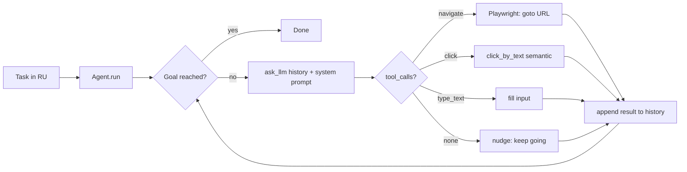
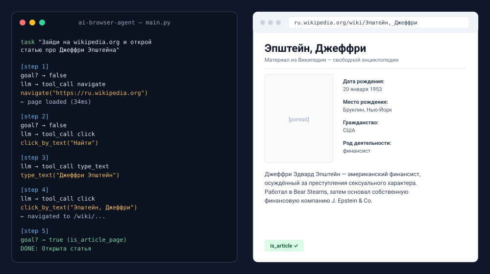

# ai-browser-agent


[](https://github.com/Pinger1456/ai-browser-agent/actions/workflows/ci.yml)

Autonomous LLM-driven browser agent. Give it a task in plain Russian, it plans the steps and executes them in a real browser via Playwright — navigating, clicking by text, typing into inputs, checking goal completion.

## How it works



Bounded to 10 steps. Each step: check goal → LLM → tool call → append → repeat.

## Run preview



_Left: bounded step loop with tool-calls. Right: final page where `is_article_page()` returns `true`._

## Shape

```
main.py                      # entry point: create BrowserController + Agent, run task
config.py                    # env-driven config (LLM + browser)
agent/
├── planner.py               # Agent.run(): step loop with LLM tool-calls
├── llm.py                   # OpenAI-compatible client (GLM/Zhipu by default)
├── system_prompt.py         # single system message: "one action per step"
├── safety.py                # keyword blocklist (оплата, удаление, платёж)
└── memory.py                # (placeholder for conversation state)
browser/
├── controller.py            # Playwright wrapper: navigate / click_by_text / type_text / scroll / is_article_page
└── dom.py                   # extract_semantic_dom() — pull first 50 buttons/links/inputs for the prompt
tools/
├── schema.py                # OpenAI tool-calling schema: navigate / click / scroll / type_text
└── actions.py               # (placeholder for reusable action helpers)
```

## Why this shape

The point wasn't to build "another Playwright wrapper with LLM". Two design lines:

- **LLM as planner, browser as pure I/O.** The agent has zero domain logic. It reads `history`, asks the LLM for the next tool call, executes it, appends the result, loops up to 10 steps. All planning lives in the LLM, all effects live in `BrowserController`.
- **Actions grounded in semantic DOM, not selectors.** `click_by_text("Джеффри Эпштейн")` uses `page.get_by_text()` which survives CSS-class churn. No `page.locator(".css-1x2y3z")` in the codebase.

## Run

```bash
python -m venv .venv
.venv\Scripts\activate  # Windows
# source .venv/bin/activate  # macOS/Linux

pip install -r requirements.txt
playwright install chromium

cp .env.example .env  # fill GLM_API_KEY at minimum
python main.py
```

The default task in `main.py` is:

```
Зайди на wikipedia.org и открой статью про Джеффри Эпштейна
```

## Environment

| Var | Default | Purpose |
|---|---|---|
| `GLM_API_KEY` | — required | GLM/Zhipu API key (OpenAI-compatible) |
| `GLM_BASE_URL` | `https://open.bigmodel.cn/api/paas/v4/` | LLM endpoint |
| `LLM_MODEL` | `glm-4-flash` | Model name |
| `LLM_TEMPERATURE` | `0.1` | Low — planner should be decisive |
| `LLM_MAX_TOKENS` | `1024` | Cap per step |
| `BROWSER_HEADLESS` | `true` | Set `false` to watch it work |
| `BROWSER_TIMEOUT_MS` | `15000` | Per-action timeout |

To swap to OpenAI or any other compat provider: change `GLM_BASE_URL` and `GLM_API_KEY`. Model name in `LLM_MODEL`. Nothing else.

## The step loop (planner)

```
for step in range(10):
    if browser reached the goal:
        return
    response = ask_llm(history)
    if response has tool_calls:
        execute each and append result
    else:
        nudge with "цель не достигнута, продолжай"
```

Bounded steps prevent infinite loops. `is_article_page()` is the goal predicate for the demo task — a real deployment would take the predicate as a parameter and let the caller define "done".

## What's NOT here (on purpose)

- No screenshot-based grounding. Purely text-based DOM inspection. For pages that hide meaningful content behind icons/canvas — this fails and it should, honestly.
- No sub-agents / multi-turn planner. Single LLM call per step, single action per step. Faster to debug, easier to reason about.
- No persistence between runs. Agent forgets everything on exit. Add `agent/memory.py` implementation if you want cross-run learning.
- No parallel tabs. One browser, one page. Simpler.

## Safety

`agent/safety.py` blocks any task containing "оплат", "удал", "подтвердить платеж". Blunt keyword filter — not a security boundary, just a guardrail against obviously wrong asks.

## Interview crib sheet

See [`INTERVIEW_NOTES.md`](./INTERVIEW_NOTES.md) — the actual reasoning behind each architectural choice, plus expected questions.

## License

MIT — see [`LICENSE`](./LICENSE).
